# ERD.md — TreeBlog 전체 데이터베이스 엔터티 관계 다이어그램 (57 Core Tables + Partitions)

> **적용 조항**: 제14조 (DB 스키마 전체 설계) 및 `01_A_TO_Z_BLUEPRINT/P_POSTGRESQL.md`
> **총 테이블 수**: **57개 정규 엔터티 테이블** (+ 월별 파티션 테이블)

---

## 1. 도메인별 핵심 관계 다이어그램 (Mermaid ER Diagram)

```mermaid
erDiagram
    users ||--o| user_profiles : "1:1 profile"
    users ||--o{ identities : "1:N OAuth/OIDC/Local"
    users ||--o{ sessions : "1:N refresh sessions"
    users ||--o{ user_roles : "N:M platform roles"
    roles ||--o{ user_roles : "assigned to"
    roles ||--o{ role_permissions : "grants"
    permissions ||--o{ role_permissions : "belongs to"
    users ||--o{ user_consents : "agrees to"

    users ||--o{ blogs : "owns (owner_user_id)"
    blogs ||--o{ blog_members : "has team members"
    users ||--o{ blog_members : "participates in"
    blogs ||--|| blog_settings : "1:1 config"
    blogs ||--o{ blog_domains : "1:N subdomains & custom domains"
    blogs ||--|| blog_themes : "1:1 active theme config"
    themes ||--o{ blog_themes : "template for"
    blogs ||--o{ blog_navigation : "1:N menu items"
    blogs ||--o{ blog_categories : "1:N 2-depth categories"
    blogs ||--o{ series : "1:N post series"

    blogs ||--o{ posts : "contains"
    users ||--o{ posts : "authors"
    blog_categories ||--o{ posts : "categorizes"
    series ||--o{ posts : "groups"
    posts ||--o{ post_revisions : "1:N version snapshots"
    posts ||--o| autosave_drafts : "1:1 active working draft"
    posts ||--o{ post_categories : "N:M categories"
    posts ||--o{ post_tags : "N:M tags"
    tags ||--o{ post_tags : "tagged on"
    posts ||--o{ post_visibility_rules : "access rules"
    posts ||--o| scheduled_publications : "1:1 schedule job"
    posts ||--o{ post_slug_history : "301 redirect history"

    blogs ||--o{ upload_sessions : "initiates upload"
    blogs ||--o{ media_assets : "owns media"
    media_assets ||--o{ media_variants : "WebP/AVIF sizes"
    media_assets ||--o{ media_processing_jobs : "async transcode/strip"
    posts ||--o{ post_media : "embeds"
    media_assets ||--o{ post_media : "referenced by"

    users ||--o{ neighbor_groups : "organizes neighbors"
    users ||--o{ follows : "follows / neighbors / mutuals"
    blogs ||--o{ follows : "followed by"
    users ||--o{ subscriptions : "subscribes to"
    blogs ||--o{ subscriptions : "subscribed by"
    posts ||--o{ comments : "has comments"
    posts ||--o{ reactions : "has reactions"
    posts ||--o{ bookmarks : "bookmarked in"
    blogs ||--o{ guestbook_entries : "has guestbook"
    users ||--o{ user_blocks : "blocks"
    users ||--|| notification_preferences : "configures alerts"
    users ||--o{ notifications : "receives"

    posts ||--|| content_quality_signals : "1:1 SimHash & quality"
    posts ||--o{ search_index_jobs : "queued for OpenSearch"
    posts ||--|| treescan_sync_state : "1:1 TreeScan sync cursor"

    moderation_cases ||--o{ user_reports : "aggregates reports"
    moderation_cases ||--o{ moderation_actions : "records decisions"
    moderation_cases ||--o{ appeals : "receives appeals"

    users ||--o{ ad_accounts : "advertiser account"
    ad_accounts ||--o{ ad_campaigns : "runs campaigns"
    blogs ||--o{ ad_placements : "configures ad slots"
    ad_campaigns ||--o{ ad_events : "logs impressions/clicks"
    blogs ||--o{ memberships : "offers paid tiers"
    users ||--o{ orders : "places orders"
    orders ||--o{ payments : "paid via PG"
    blogs ||--o{ payouts : "withdraws revenue"
    users ||--o{ ledger_entries : "double-entry accounting"
```

---

## 2. 참조 무결성 및 삭제 정책(ON DELETE Policy) 설계 원칙

| 삭제 정책 유형 | 적용 대상 테이블 관계 | 아키텍처 근거 |
| :--- | :--- | :--- |
| **`ON DELETE RESTRICT`** | `posts.author_user_id`, `orders.buyer_user_id`, `payments.order_id`, `payouts.payee_user_id`, `ledger_entries.owner_user_id`, `audit_logs.actor_user_id`, `moderation_actions.case_id` | 금전 거래 원장, 결제/정산 기록, 보안 감사 로그, 법적 분쟁 증빙은 계정 탈퇴나 상위 엔터티 삭제 시에도 절대 연쇄 삭제되어서는 안 된다. |
| **`ON DELETE CASCADE`** | `user_profiles`, `identities`, `sessions`, `blog_settings`, `blog_themes`, `post_revisions`, `autosave_drafts`, `media_variants`, `follows`, `subscriptions`, `bookmarks` | 부모 엔터티(예: `posts` 또는 `blogs`)가 영구 파기(`PURGED`)될 때 독립적인 존재 의미가 없는 종속 데이터는 깔끔하게 함께 정리한다. |
| **`ON DELETE SET NULL`** | `posts.category_id`, `posts.series_id`, `blog_categories.parent_id`, `follows.neighbor_group_id`, `moderation_cases.assigned_mod_id` | 카테고리, 시리즈, 이웃 폴더가 삭제되더라도 게시글이나 이웃 관계 자체는 삭제되지 않고 '미분류' 상태로 안전하게 보존되어야 한다. |
