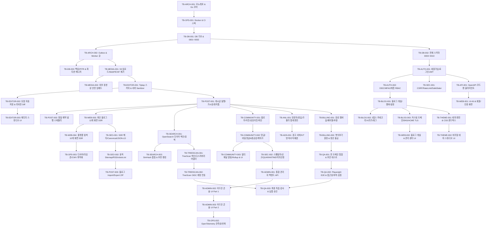

# DEPENDENCY_GRAPH.md — Work Order 실행 의존성 DAG 및 병렬화 설계

## 1. Phase 0 ~ Phase 10 실행 의존성 그래프 (Mermaid DAG)

## 2. DAG 무결성 및 병렬 실행 슬롯 검증
- **순환 의존성(Cycle) 검사 결과**: `0 Cycles Detected (Topological Sort Validated)`.
- **최대 병렬 실행 구간**: `TB-BLOG-001` 및 `TB-POST-001` 완료 직후, `Media Agent`, `Editor Agent`, `Theme/Frontend Agent`, `Search/SEO Agent`, `Community Agent`, `Analytics/Billing Agent`가 각자 독점 소유한 디렉터리에서 충돌 없이 6-Way 병렬 개발을 수행할 수 있다.
